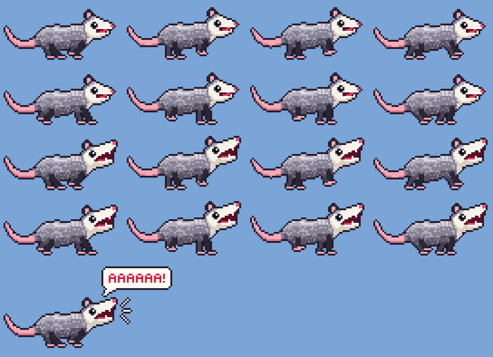

# Possum

**Possum is the perfect empathic digital companion for your stressful
workday.** When the build breaks, the meeting runs over, and the inbox keeps
filling up, a small pixel-art opossum runs laps around the edge of your
screen and screams on your behalf, so you don't have to. It never judges,
never asks for a status update, and always understands exactly how you feel.

A native macOS app, written in Rust, that releases a pixel-art opossum onto
your screen. It runs **counterclockwise around the edge of the screen** with
its **mouth hanging open**, and every few seconds it **screams**: the jaw
drops, yell marks shoot out of its mouth, it shakes, it speeds up, and you
hear it. It alternates between two sounds: a cartoon `AAAAAAAA!` and a long,
open-mouthed hiss modelled on real Virginia opossum recordings.

It is a tribute to the **«бежит орёт»** ("runs, screams") opossum meme: the
screaming frames copy its thrown-back head and gaping, fang-filled jaws.



*Regenerate this sheet with `cargo run -- --preview sheet.png`.*

## Run it

```sh
cargo run --release          # straight from the terminal
./bundle.sh && open dist/Possum.app   # or as a real .app bundle
```

The possum starts at the bottom-left corner and screams right away. It
appears on every Space (full-screen apps included), runs over the menu bar
and the Dock, and ignores mouse clicks, so it never gets in your way.

## The menu

Click the little screaming possum head in the menu bar:

| Item | What it does |
|------|--------------|
| **Scream** *(default)* | You hear the scream; no speech bubble |
| **Scream silently** | No sound; an upright speech bubble instead (`AAAAAAAAH!` or `HSSSSSS!`) |
| **Scream Now** | Makes it scream right away |
| **Quit Possum** | Quits (Ctrl+C also works if you started it from a terminal) |

## Options

```
--scale <N>        Size of one sprite pixel in points (default 3)
--speed <N>        Running speed in points per second (default 260)
--volume <0..1>    Scream volume (default 0.6)
--silent           Start in "Scream silently" mode (bubble, no sound)
--start <0..1>     Where on the border to start, as a fraction of one lap
--preview <FILE>   Write a PNG sprite sheet and exit
--iconset <DIR>    Write a macOS .iconset folder and exit
```

For example, `cargo run --release -- --scale 4 --speed 400` gives you a big,
fast possum.

## How it works

| File            | What's in it |
|-----------------|--------------|
| `src/main.rs`   | AppKit + Core Animation: the overlay window, the layers, the 60 Hz timer, the menu-bar item |
| `src/sprite.rs` | The pixel art. Hand-drawn head grids plus procedurally drawn body, tail, and 8-frame gallop, with an automatic 1px outline |
| `src/track.rs`  | The screen border as a rounded rectangle, walked counterclockwise |
| `src/scream.rs` | Sound synthesis: the cartoon "AAAA" voice and a Virginia opossum long hiss, written out as WAV |
| `src/png.rs`    | A tiny PNG encoder for `--preview` and the app icon |

* **One transparent window, moved by Core Animation.** A borderless,
  click-through window covers the primary screen at status-bar level. The
  possum is a `CALayer` inside it whose *anchor point is at its paws*. Each
  tick the layer moves along the track and rotates to the direction of
  travel, so the paws always touch the screen edge. Counterclockwise is just
  a heading angle that keeps increasing: 0° → 90° → 180° → 270°.
* **Crisp pixels.** Frames are tiny native-resolution `CGImage`s (64×32)
  scaled up with `kCAFilterNearest`, so they stay sharp on Retina displays.
* **Readable screams.** The speech bubble is *not* a child of the rotating
  possum layer. It is placed separately, always upright, ahead of the head
  and toward the middle of the screen.
* **No assets.** Every pixel and every scream is generated at startup. The
  release binary is about 400 KB and uses roughly 1% CPU.

Only the primary display (the one with the menu bar) is used. If you change
the resolution or rearrange displays, the possum adjusts its track within a
second.

## Tests

```sh
cargo test
```

The tests cover the counterclockwise track geometry and its continuity, the
WAV and PNG encoders, the sprite frame invariants (paws on the ground in every
frame), and the placement of the speech-bubble pointer.

## Sound design

The sounds are generated from scratch at startup, so the app ships no audio
files. The possum alternates between two of them: "AAAA", hiss, "AAAA",
hiss...

| Sound | Modelled on | Synthesized as |
|---|---|---|
| **"AAAA"** | Nothing real: the cartoon scream from the first version | A jittery sawtooth voice through "AAAA" vowel formants, 1.1-1.7 s, unchanged (a test pins it, bit for bit, to the original) |
| **Long hiss** | The long, open-mouthed hiss of a Virginia opossum: breath noise centred near 2 kHz, most of its energy at 1-3 kHz, little above 6 kHz | White noise through broad filters plus a low-pass, a 60 ms rise, a slowly drifting force, and a fade. Real hisses last ~0.6 s; this one lasts 1-1.6 s |

The hiss was tuned by measuring it against the recordings. The real long
hiss and the synthesized one both have a spectral centroid of about 2 kHz,
with roughly 40-60% of their energy at 1-3 kHz and under 10% above 6 kHz.

The reference recordings were used only for analysis and are not part of
this repository. They are iNaturalist observations of the Virginia opossum
(*Didelphis virginiana*) whose species was confirmed by the community:
[40653183](https://www.inaturalist.org/observations/40653183) (the long hiss
the model is based on), plus
[112927147](https://www.inaturalist.org/observations/112927147),
[163147267](https://www.inaturalist.org/observations/163147267) and
[407756659](https://www.inaturalist.org/observations/407756659).

## License

[POSSUM LICENSE 1.0](LICENSE): the MIT license plus one condition. Anyone who
uses or forks this repository must imitate a possum scream, out loud, at least
once. An `AAAAAAAA!` or a long `HSSSSSSSS!` will do, and no witnesses are
required.
