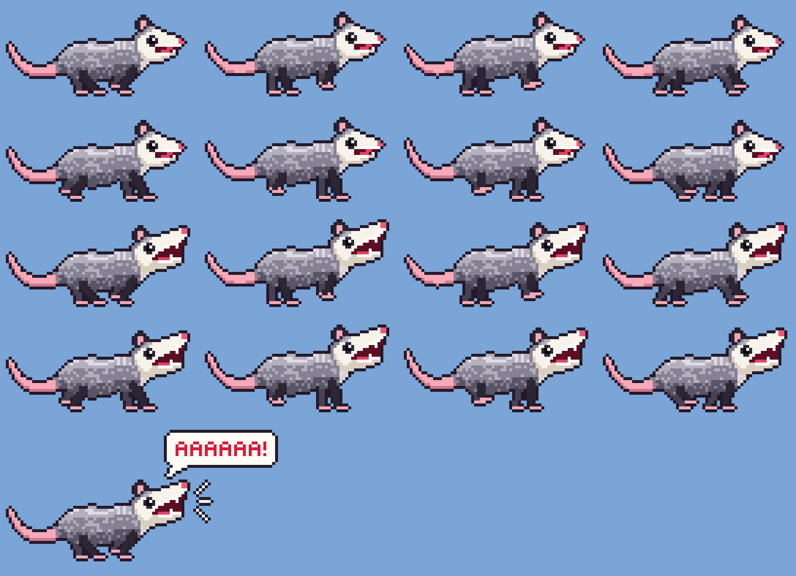

# Possum guide

Everything about Possum in detail. For the short version, see the [README](../README.md).

- [What it does, in detail](#what-it-does-in-detail)
- [Requirements](#requirements)
- [Run it](#run-it)
- [Installing](#installing)
- [The menu](#the-menu)
- [Options](#options)
- [How it works](#how-it-works)
- [Staying quiet](#staying-quiet)
- [Multiple displays](#multiple-displays)
- [Sound design](#sound-design)
- [Sprite sheet](#sprite-sheet)
- [Tests](#tests)

## What it does, in detail

- The possum runs **counterclockwise** around the edge of your screen, mouth
  hanging open. It runs over the menu bar and the Dock, and it shows up on
  every Space, full-screen apps included.
- Every few seconds it **screams**: the jaw drops, it shakes, and it speeds
  up. It alternates between a cartoon `AAAAAAAA!` and a long hiss modelled on
  real Virginia opossum recordings (see [Sound design](#sound-design)).
- From its menu-bar icon you can switch between **Scream** (with sound) and
  **Scream silently** (a speech bubble instead), or make it **Scream Now**
  (see [The menu](#the-menu)).
- It ignores clicks and never steals focus, so it never gets in your way.
- It keeps quiet while the screen is locked, the display is off, or the
  screensaver is running (see [Staying quiet](#staying-quiet)).
- It always runs around your main display (the one with the menu bar), and
  follows it when that changes (see [Multiple displays](#multiple-displays)).

It's a tribute to the **«бежит орёт»** ("runs, screams") opossum meme.

## Requirements

Possum is a **macOS-only** app. It is built directly on AppKit and Core
Animation, Apple's own UI frameworks, so it does not build or run on Windows
or Linux.

| | |
|---|---|
| **macOS** | 11 Big Sur or later (the app bundle's minimum). Developed and tested on macOS 27 |
| **Mac** | Apple Silicon or Intel. `bundle.sh` builds one universal app that runs natively on both. Tested on Apple Silicon, and the Intel build under Rosetta 2 (same test results, same pixels) |
| **To build** | Rust 1.85 or newer, plus the Xcode Command Line Tools (`xcode-select --install`). They provide the linker, and the `codesign`, `iconutil` and `lipo` tools that `bundle.sh` uses. For a universal app, also both Rust targets: `rustup target add aarch64-apple-darwin x86_64-apple-darwin` |
| **Permissions** | None. It doesn't need Accessibility, Screen Recording, or microphone access |

## Run it

```sh
cargo run --release                    # straight from the terminal
./bundle.sh && open dist/Possum.app    # or as a real .app bundle
```

The possum starts at the bottom-left corner and screams right away. It
appears on every Space (full-screen apps included), runs over the menu bar
and the Dock, and ignores mouse clicks, so it never gets in your way.

`bundle.sh` builds a **universal** app (Apple Silicon + Intel) when both Rust
targets are installed. Otherwise it builds for Apple Silicon Macs only
(Intel only, if you build on an Intel Mac) and tells you how to add the
missing target. You can also choose:

```sh
./bundle.sh --universal   # Apple Silicon + Intel, or fail if a target is missing
./bundle.sh --native      # Apple Silicon only (Intel on an Intel Mac); fastest
```

## Installing

- **Keep it:** drag `dist/Possum.app` into `/Applications`.
- **Finding it:** Possum has no Dock icon and doesn't appear in the
  Command-Tab switcher. It lives in the menu bar, as a little screaming
  possum head.
- **Start at login:** System Settings → General → Login Items → **+** →
  Possum.
- **Copying it to another Mac:** a universal build runs on both Apple
  Silicon and Intel Macs. A `--native` build made on an Apple Silicon Mac
  runs only on Apple Silicon Macs.
  The app is signed ad hoc, without an Apple Developer ID or notarization,
  so on another Mac, Gatekeeper blocks it the first time. Open it anyway
  from System Settings → Privacy & Security → **Open Anyway** (on macOS 14
  and earlier, Control-click → Open also works), or build it on that Mac
  with `./bundle.sh`.

## The menu

Click the little screaming possum head in the menu bar:

| Item | What it does |
|------|--------------|
| **Scream** *(default)* | You hear the scream; no speech bubble |
| **Scream silently** | No sound; an upright speech bubble instead (`AAAAAAAAH!` or `HSSSSSS!`) |
| **Scream Now** | Makes it scream right away |
| **Quit Possum** | Quits (Ctrl+C also works if you started it from a terminal) |

## Options

```
--scale <N>        Size of one sprite pixel in points (default 3)
--speed <N>        Running speed in points per second (default 260)
--volume <0..1>    Scream volume (default 0.6)
--silent           Start in "Scream silently" mode (bubble, no sound)
-v, --verbose      Log screams, quiet times and display changes to the terminal
--start <0..1>     Where on the border to start, as a fraction of one lap
--preview <FILE>   Write a PNG sprite sheet and exit
--portrait <FILE>  Write a PNG of the screaming possum and exit
--iconset <DIR>    Write a macOS .iconset folder and exit
```

For example, `cargo run --release -- --scale 4 --speed 400` gives you a big,
fast possum.

## How it works

| File            | What's in it |
|-----------------|--------------|
| `src/main.rs`   | AppKit + Core Animation: the overlay window, the layers, the 60 Hz timer, the menu-bar item |
| `src/sprite.rs` | The pixel art. Hand-drawn head grids plus procedurally drawn body, tail, and 8-frame gallop, with an automatic 1px outline |
| `src/track.rs`  | The screen border as a rounded rectangle, walked counterclockwise |
| `src/scream.rs` | Sound synthesis: the cartoon "AAAA" voice and a Virginia opossum long hiss, written out as WAV |
| `src/png.rs`    | A tiny PNG encoder for the sprite sheet and the app icon |

* **One transparent window, moved by Core Animation.** A borderless,
  click-through window covers the primary screen at status-bar level. The
  possum is a `CALayer` inside it whose *anchor point is at its paws*. Each
  tick the layer moves along the track and rotates to the direction of
  travel, so the paws always touch the screen edge. Counterclockwise is just
  a heading angle that keeps increasing: 0° → 90° → 180° → 270°.
* **Crisp pixels.** Frames are tiny native-resolution `CGImage`s (64×32)
  scaled up with `kCAFilterNearest`, so they stay sharp on any display,
  Retina or not.
* **Readable screams.** The speech bubble is *not* a child of the rotating
  possum layer. It is placed separately, always upright, ahead of the head
  and toward the middle of the screen.
* **No assets.** Every pixel and every scream is generated at startup. The
  universal binary is under 1 MB. On an Apple Silicon Mac it uses about 1%
  CPU.

Nothing depends on a particular screen: the track is measured from the
primary display at runtime, whatever its size or resolution. On MacBooks with
a camera notch, the possum briefly runs behind the notch on the top edge.

## Staying quiet

The possum never makes a sound while:

- the screen is **locked**,
- the **screensaver** is running,
- the main **display is off** (asleep),
- **another user** is using the screen (fast user switching), or
- the Mac is **going to sleep**.

A scream that's playing when one of these starts is cut off at once. Screams
that come due meanwhile are skipped silently, and the possum keeps running
(not that anyone can see it). As soon as everything is back, it's free to
scream again.

It keeps track in two ways, so it can't miss a change:

1. **Notifications, for an instant reaction.** macOS announces lock/unlock
   and screensaver start/stop to every app (`com.apple.screenIsLocked`,
   `com.apple.screensaver.didstart`, and their opposites), and `NSWorkspace`
   announces displays sleeping and waking, session switches, and system
   sleep. macOS normally holds these back from inactive apps, and a menu-bar
   app is never active, so Possum asks for them to be delivered immediately.
2. **A direct check, once a second and right before every scream.** It reads
   the session's lock flag and whether this user owns the screen
   (`CGSessionCopyCurrentDictionary`), whether the main display is asleep
   (`CGDisplayIsAsleep`), and whether the screensaver app is running. That
   catches anything a notification missed, including states that were
   already true when Possum started.

Run it with `--verbose` to watch this happen. Starting the screensaver for a
few seconds looks like this (macOS also marks the session as locked while
the screensaver runs, so both show up):

```
possum [    0.43s] AAAA: out loud
possum [    2.98s] macOS says: ScreensaverStarted
possum [    2.98s] keeping quiet: the screensaver is running
possum [    3.05s] macOS says: ScreenLocked
possum [    3.85s] hiss: no sound, because the screen is locked
possum [    6.50s] AAAA: no sound, because the screen is locked
possum [   14.21s] macOS says: ScreensaverStopped
possum [   14.23s] macOS says: ScreenUnlocked
possum [   14.23s] free to scream again
possum [   15.79s] hiss: out loud
```

## Multiple displays

The possum runs around the **primary display**: the one with the menu bar.
Other displays are left alone, so it's always on the screen you look at
most.

It moves when the primary display changes:

| What happens | What the possum does |
|---|---|
| You change the main display's **resolution** | Keeps running on the new size |
| You drag the **menu bar to another monitor** (System Settings → Displays → Arrange) | Moves to that monitor |
| You **unplug** the main monitor | Moves to the display that takes over the menu bar |
| You **plug in** a second monitor | Stays where it is, unless the new monitor becomes the main one |
| macOS briefly reports **no display** while reconfiguring | Waits until a display is back |

When it moves, it keeps going from **the same spot on the same edge**: if it
was halfway up the right edge, it continues halfway up the right edge of the
new screen, even if the new screen has a completely different shape.

It notices changes right away, from macOS's "screen parameters changed"
notification, and also re-checks every second as a backup. That check looks
at the primary display's frame *and* where the overlay window really is. The
second part matters when the menu bar moves between two identical monitors:
the primary frame looks exactly the same before and after, and only the
window's position shows that it's on the wrong monitor.

## Sound design

The sounds are generated from scratch at startup, so the app ships no audio
files. The possum alternates between two of them: "AAAA", hiss, "AAAA",
hiss...

| Sound | Modelled on | Synthesized as |
|---|---|---|
| **"AAAA"** | Nothing real: the cartoon scream from the first version | A jittery sawtooth voice through "AAAA" vowel formants, 1.1-1.7 s, unchanged (a test pins it, bit for bit, to the original) |
| **Long hiss** | The long, open-mouthed hiss of a Virginia opossum: breath noise centred near 2 kHz, most of its energy at 1-3 kHz, little above 6 kHz | White noise through broad filters plus a low-pass, a 60 ms rise, a slowly drifting force, and a fade. Real hisses last ~0.6 s; this one lasts 1-1.6 s |

The hiss was tuned by measuring it against the recordings. The real long
hiss and the synthesized one both have a spectral centroid of about 2 kHz,
with roughly 40-60% of their energy at 1-3 kHz and under 10% above 6 kHz.

The reference recordings were used only for analysis and are not part of
this repository. They are iNaturalist observations of the Virginia opossum
(*Didelphis virginiana*) whose species was confirmed by the community:
[40653183](https://www.inaturalist.org/observations/40653183) (the long hiss
the model is based on), plus
[112927147](https://www.inaturalist.org/observations/112927147),
[163147267](https://www.inaturalist.org/observations/163147267) and
[407756659](https://www.inaturalist.org/observations/407756659).

## Sprite sheet



The top two rows are the 8-frame run cycle, mouth hanging open. The next two
are the scream cycle, head thrown back like the «бежит орёт» meme. Regenerate
the sheet with `cargo run -- --preview sheet.png`, and the picture at the top
of the README with `cargo run -- --portrait possum.png`.

## Tests

```sh
cargo test --target aarch64-apple-darwin    # Apple Silicon (needs an Apple Silicon Mac)
cargo test --target x86_64-apple-darwin     # Intel (runs via Rosetta on an Apple Silicon Mac)
```

The tests cover the counterclockwise track geometry and its continuity on
screens of every shape; keeping the same edge after a screen change;
following the primary display through every kind of display change; the
quiet-time state machine (every lock, screensaver, display and sleep event,
and the once-a-second check); the WAV and PNG encoders; the sprite frame
invariants (paws on the ground in every frame); the speech-bubble pointer and
font; the shape of the long hiss; and a golden checksum that keeps the "AAAA"
voice identical to the original. That checksum differs per architecture:
Apple's math library rounds a few last bits differently on Intel, so about 2%
of samples differ by one step out of 32,767 (inaudible).
