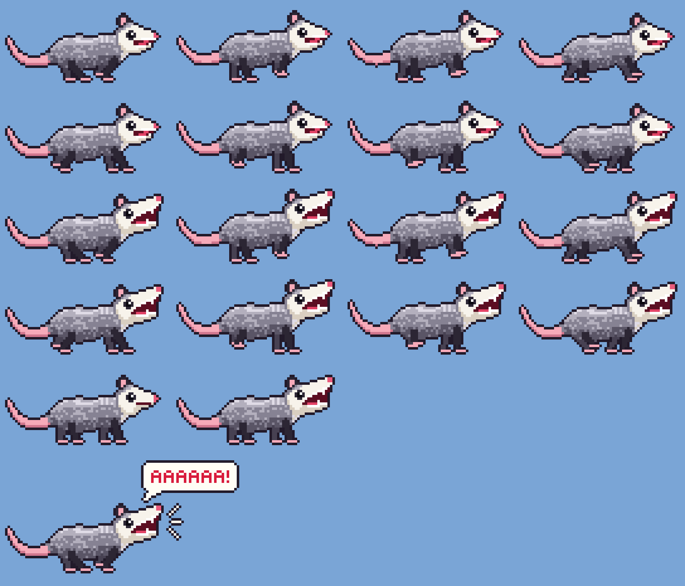

# Possum guide

Everything about Possum in detail. For the short version, see the [README](../README.md).

- [What it does, in detail](#what-it-does-in-detail)
- [Possum in your pocket! (Android and Samsung DeX)](#possum-in-your-pocket-android-and-samsung-dex)
- [Requirements](#requirements)
- [Download](#download)
- [Build and run on macOS](#build-and-run-on-macos)
- [Build and run on Windows](#build-and-run-on-windows)
- [Build and run on Linux](#build-and-run-on-linux)
- [Build and run on Android](#build-and-run-on-android)
- [Wine: the Windows version on a Mac or Linux](#wine-the-windows-version-on-a-mac-or-linux)
- [Installing](#installing)
- [The menu](#the-menu)
- [Options](#options)
- [How it works](#how-it-works)
- [Staying quiet](#staying-quiet)
- [Multiple displays](#multiple-displays)
- [Sound design](#sound-design)
- [Sprite sheet](#sprite-sheet)
- [Tests](#tests)

## What it does, in detail

- The possum runs **counterclockwise** around the edge of your screen, mouth
  hanging open. It runs over everything: the macOS menu bar and Dock, the
  Windows taskbar, Linux panels and docks.
- Every few seconds it **screams**: the jaw drops, it shakes, and it speeds
  up. It alternates between a cartoon `AAAAAAAA!` and a long hiss modelled on
  real Virginia opossum recordings (see [Sound design](#sound-design)).
- From its menu-bar or tray icon you can switch between **Scream** (with
  sound) and **Scream silently** (a speech bubble instead), or make it
  **Scream Now** (see [The menu](#the-menu)).
- It ignores clicks and never steals focus, so it never gets in your way.
- It keeps quiet while the screen is locked, the display is off, or the
  screensaver is running (see [Staying quiet](#staying-quiet)).
- It always runs around your main display, and follows it when that
  changes (see [Multiple displays](#multiple-displays)).

It's a tribute to the **«бежит орёт»** ("runs, screams") opossum meme.

## Possum in your pocket! (Android and Samsung DeX)

No computer around, just a TV or a monitor? Your phone is all the possum
needs. Plug a Samsung Galaxy phone into any TV or monitor (a USB-C to HDMI
cable or adapter is enough, or connect wirelessly to a TV that supports
screen mirroring), and Samsung DeX turns that screen into a desktop. Within
a second, Possum moves over to it by itself and runs laps around the big
screen, screaming on your behalf: in a hotel room, at a friend's place, on
the meeting-room display, on the TV at home. Unplug, and it's back on your
phone, ready for the next screen. No laptop to carry, nothing to install on
the TV. Android's own desktop mode on a connected display works the same
way, and on a phone or tablet with no display connected, the possum runs
around its own screen.

It's the same possum: the Android app runs the very same Rust code for the
brain, the sprites and the screams, with a small Java app around it.

- **The menu** is Possum's notification: **Scream** / **Scream silently**,
  **Scream Now** and **Quit Possum**.
- **Keeping quiet:** besides a locked screen and a display that's off, it
  screams silently (in speech bubbles) while the phone is on silent, in Do
  Not Disturb, or in a call.
- **What Android doesn't allow:** the status bar, the taskbar, the
  notification shade and the lock screen stay above other apps' windows, so
  the possum runs inside the system bars rather than over them; and Android
  only lets taps through another app's window while it's at most 80%
  opaque, so the possum is drawn very slightly see-through.

Install it from a release (see [Download](#download)); building it and
everything else is in [android/README.md](../android/README.md).

## Requirements

| | macOS | Windows | Linux | Android |
|---|---|---|---|---|
| **System** | macOS 11 Big Sur or later | Windows 10 (version 1703 or later) or Windows 11 | Tested on **Ubuntu 26.04 LTS and 26.10, Fedora 45, Debian 13**; other distributions with X11 or XWayland should work | Android 12 or later; for a monitor or TV, Samsung DeX or Android's desktop mode |
| **Processor** | Apple Silicon or Intel (one universal app) | x86-64; Windows on Arm runs it through its built-in emulation (or [build it for ARM64](#windows-on-arm)) | x86-64 or ARM64 | ARM64 (every phone and tablet with DeX), or x86-64 |
| **To build** | Rust 1.100+ and the Xcode Command Line Tools | Rust 1.100+ and the Visual Studio C++ Build Tools | Rust 1.100+ and `gcc` (as the linker) | Rust 1.100+, the Android SDK and NDK, and JDK 17+ |
| **To run** | Nothing else | Nothing else | An X11 session, or a Wayland session with XWayland (GNOME and KDE start it automatically); one of `pw-play`, `paplay` or `aplay` for sound (desktop installs have at least one) | Nothing else |
| **Permissions** | None | None | None | **Appear on top**, and notifications (its menu) |

Possum builds with Rust 1.100, the version in `rust-toolchain.toml`:
install Rust from [rustup.rs](https://rustup.rs) and `cargo` fetches that
version by itself the first time. Linux distributions' own Rust packages are
older, so they won't do.

## Download

Ready-made builds are on the
[Releases](https://github.com/natchster/possum/releases) page. Every change
to Possum is released, numbered 1.0, 1.1, 1.2 and so on; the newest is
marked **Latest**, and its notes say what changed. Download the file for
your system from its **Assets**:

| File | For |
|---|---|
| `Possum-<version>-macos-apple-silicon.zip` | Macs with Apple Silicon (M1 and later), macOS 11+ |
| `Possum-<version>-macos-universal.zip` | Any Mac with macOS 11+, Apple Silicon or Intel (twice the size) |
| `possum-<version>-windows-x86_64.zip` | Windows 10 (1703+) and 11, including Windows on Arm |
| `possum_<version>_amd64.deb`, `_arm64.deb` | Ubuntu, Debian and their relatives |
| `possum-<version>-1.x86_64.rpm`, `.aarch64.rpm` | Fedora and its relatives |
| `possum-<version>-linux-x86_64.tar.gz`, `-aarch64.tar.gz` | Any Linux with glibc 2.39 or newer (Ubuntu 24.04+, Debian 13+, Fedora 40+) |
| `Possum-<version>-android.apk` | Android 12+ phones and tablets, Samsung DeX included |

Not sure which processor you have? On a Mac, Apple menu → About This Mac says "Chip:
Apple M…" or "Processor: Intel". On Linux, `uname -m` prints `x86_64`
(amd64) or `aarch64` (arm64).

**macOS:** double-click the zip to unpack `Possum.app` and drag it into
Applications. It's signed ad hoc, not with an Apple Developer ID, and isn't
notarized, so the first time you open it macOS says it can't verify it.
Click **Done**, then open System Settings → Privacy & Security, scroll down
to "Possum was blocked" and click **Open Anyway**. After that it opens like
any app. (In a terminal, `xattr -dr com.apple.quarantine
/Applications/Possum.app` does the same.)

**Windows:** unpack the zip and run `possum.exe`; it's a single file and
needs nothing else installed (not even the Visual C++ runtime). It isn't
signed, so the first time SmartScreen may say "Windows protected your PC":
click **More info → Run anyway**.

**Linux:** install the package for your distribution, with its file name in
place of these:

```sh
sudo apt install ./possum_1.0_amd64.deb         # Ubuntu, Debian
sudo dnf install ./possum-1.0-1.x86_64.rpm      # Fedora
```

Possum then shows up in your app list, and `possum` works in a terminal.
The packages recommend a sound player (`pw-play`, `paplay` or `aplay`),
which desktop installs already have. Uninstall with `sudo apt remove
possum` or `sudo dnf remove possum`.

The tarball holds the same files as the packages, under `bin/` and
`share/`. Run `bin/possum` straight from it, or install it for yourself
only, app-list entry and icon included, with no root needed:

```sh
tar -xzf possum-1.0-linux-x86_64.tar.gz -C ~/.local --strip-components=1
```

(That puts `possum` in `~/.local/bin`, which Ubuntu, Debian and Fedora add
to your PATH once the folder exists; log out and back in if `possum` isn't
found.)

**Android:** download the APK on the phone (or copy it there) and open it.
Android asks whether the browser (or Files) may install apps: allow it, and
install. Open **Possum**: it asks to show notifications (its menu), then for
**Appear on top**; switch that on and go back, and the possum starts
running. On Android 15 and newer, that switch is greyed out for apps
installed from a file: open App info, tap ⋮, choose **Allow restricted
settings**, and switch it on again. If it stops by itself after a while,
battery saving put it to sleep: App info → Battery → **Unrestricted**.
Releases are signed with the same key, so a new one installs over the old
one, settings and all.

**How they're made:** see [Release builds](#release-builds) under Tests.

## Build and run on macOS

1. Install the Xcode Command Line Tools: `xcode-select --install`.
2. Install Rust from [rustup.rs](https://rustup.rs).
3. Get the code and build the app:

   ```sh
   git clone https://github.com/natchster/possum
   cd possum
   ./bundle.sh && open dist/Possum.app
   ```

`cargo run --release` also works, straight from the terminal.

`bundle.sh` builds a **universal** app (Apple Silicon + Intel) when both Rust
targets are installed (`rustup target add aarch64-apple-darwin
x86_64-apple-darwin`). Otherwise it builds for Apple Silicon Macs only
(Intel only, if you build on an Intel Mac) and tells you how to add the
missing target. You can also choose:

```sh
./bundle.sh --universal   # Apple Silicon + Intel, or fail if a target is missing
./bundle.sh --native      # Apple Silicon only (Intel on an Intel Mac); fastest
```

## Build and run on Windows

1. Install Rust with `rustup-init.exe` from [rustup.rs](https://rustup.rs).
   When it asks, let it install the **Visual Studio C++ Build Tools**: Rust
   uses their linker.
2. Get the code, with Git (`git clone https://github.com/natchster/possum`)
   or GitHub's **Code → Download ZIP**, and open a terminal in it.
3. Build it:

   ```powershell
   cargo build --release
   ```

4. Run `target\release\possum.exe`. Double-clicking it works: it's a normal
   Windows app with no console window. Started from a terminal, it prints
   there, so `target\release\possum.exe --verbose` shows its log.

Windows scales the possum like everything else: at 150% display scaling it's
1.5 times bigger, so it looks the same size as on a Mac.

### Windows on Arm

Releases ship the x86-64 `possum.exe`, which Windows on Arm runs through its
built-in emulation. A native ARM64 one builds the same way, with Visual
Studio's ARM64 build tools installed:

```powershell
rustup target add aarch64-pc-windows-msvc
cargo build --release --target aarch64-pc-windows-msvc
target\aarch64-pc-windows-msvc\release\possum.exe
```

On a Mac or Linux, `cargo xwin build --release --target
aarch64-pc-windows-msvc` cross-builds it, and `./windows-test.sh --arm64`
tests it (see [Wine](#wine-the-windows-version-on-a-mac-or-linux)).

## Build and run on Linux

1. Install a linker and Git with your distribution's packages, and Rust
   from [rustup.rs](https://rustup.rs) (distributions package older Rust):

   ```sh
   sudo apt install gcc git      # Ubuntu, Debian
   sudo dnf install gcc git      # Fedora
   curl --proto '=https' --tlsv1.2 -sSf https://sh.rustup.rs | sh
   ```
2. Get the code and build it:

   ```sh
   git clone https://github.com/natchster/possum
   cd possum
   cargo build --release
   ./target/release/possum
   ```

No other libraries are needed to build: the X11 and D-Bus code is pure
Rust.

Good to know:

- **Wayland:** Possum is an X11 app. On Wayland desktops it runs through
  XWayland, which GNOME and KDE start automatically. It has been run on
  Ubuntu 26.04's GNOME on Wayland (see [Tests](#tests)): it runs over the
  top bar and the dock, its tray icon and menu work, and locking the screen
  silences it. GNOME starts XWayland only when the first X11 app opens, so
  Possum often starts it; it then waits a few milliseconds for GNOME to
  take over before showing its windows, because XWayland 24.1 crashes if a
  window shown earlier is moved (see [How it works](#how-it-works)).
- **The tray icon** uses the StatusNotifierItem standard. KDE shows it out
  of the box; on GNOME it needs the AppIndicator extension, which Ubuntu
  ships enabled. On Fedora or Debian with GNOME, install
  `gnome-shell-extension-appindicator` and turn it on in Extensions.
  Without a tray, quit with `pkill possum` (or Ctrl+C if you started it in a
  terminal), and use `--silent` for silent mode.
- **Sound** plays through `pw-play` (PipeWire), `paplay` (PulseAudio) or
  `aplay` (ALSA), whichever is installed. If none is, Possum says so once
  and screams silently.

## Build and run on Android

Possum's Android app is in [`android/`](../android): the shared Rust code as
a library, and a small Java app around it, built with the Android SDK's own
tools (no Gradle). With the Android SDK (platform 36, build-tools and the
NDK), JDK 17 or newer, and Rust from rustup:

```sh
rustup target add aarch64-linux-android x86_64-linux-android
./android/build.sh
adb install -r dist/Possum-*-android.apk
```

The APK has the Rust core for ARM64 and x86-64. Built this way it's signed
with your computer's Android debug key, so uninstall a release before
installing your own build, and the other way round. Everything else
(installing the SDK, what each Java file does, logs) is in
[android/README.md](../android/README.md).

## Wine: the Windows version on a Mac or Linux

[Wine](https://www.winehq.org) runs Windows programs on macOS and Linux,
and Possum's `possum.exe` runs in it. For using Possum, the native versions
are better on both (Possum.app on a Mac, the packages on Linux): smaller,
and without Wine's limits. Wine is for trying and testing the Windows
version. This section has the scripts for both, and for a Mac app made of
`possum.exe` and Wine.

### Running it

- **Linux:** install Wine from your distribution (`sudo apt install wine`,
  `sudo dnf install wine`) and run `wine possum.exe`, from a release's zip
  or built by `./windows-test.sh --app` (below).
- **Mac:** `./windows-test.sh --run` builds it and runs it with WineHQ's
  Wine until you choose **Quit Possum** (log in `target/windows-run.log`),
  or build [the Mac app](#a-mac-app-possum-wineapp) and double-click it.
  Don't double-click `possum.exe` in the Finder: that starts it through the
  "Wine Devel" app, which stays in the Dock with Wine's icon, and when that
  app quits, macOS ends the Wine processes it started, Wine's server among
  them. Possum can't go on without it: it freezes where it is, menu and
  all, until it's force-quit.

With `--verbose`, the Windows version also logs its sounds, clicks on its
tray icon, its menu, and any frame that comes late, so a log shows where it
stopped.

Under Wine on a Mac, the possum runs over the desktop, cut cleanly to its
outline, screams on time, and shows speech bubbles; its tray icon appears in
the menu bar, and its menu opens under it and works down to **Quit
Possum**. Its icon in the Dock is Possum's own: `possum.exe` carries it
(drawn from the same sprite by `build.rs`), and Windows shows it for the
file too. But Wine isn't Windows. The menu bar and the Dock stay above every
app's windows, and macOS moves any window reaching above the menu bar down
below it; so Possum, which recognises Wine on a Mac, runs around the space
between them instead of the whole screen. A click outside Wine's windows
doesn't reach Wine, so it can't close the menu: a second click on the icon
does. And locking the Mac isn't locking Windows, so it doesn't keep quiet
while the Mac is locked.

### Testing it

```sh
./windows-test.sh
```

builds the same `possum.exe` that releases ship (x86_64, Microsoft's C
runtime linked in) with [cargo-xwin](https://github.com/rust-cross/cargo-xwin)
and zips it like a release (`dist/possum-<version>-windows-x86_64.zip`),
runs the tests under Wine, then runs the app for 10 seconds and saves its
log and a screenshot of the whole screen in `target/`. Then it tries the
tray menu: it opens it, closes it with a second click on the icon, chooses
**Scream Now**, and quits with **Quit Possum**, all through the messages
Windows would send (a small helper,
[`tools/wine-driver`](../tools/wine-driver/src/main.rs), posts them from
inside Wine), so your own mouse and keyboard are left alone. `--tests` runs
only the tests, `--app 30` only the app (for 30 seconds), `--sound` lets it
scream out loud, and `--arm64` does all of it with `possum.exe` built for
Windows on Arm: on an Apple Silicon Mac, in the native ARM64 Wine that the
Mac app below uses (build the app first: that downloads it).

The first run sets everything up in a cache folder
(`~/Library/Caches/possum` on a Mac, `~/.cache/possum` on Linux; about
2.5 GB; nothing system-wide, no `sudo`): cargo-xwin, Microsoft's C runtime
and Windows SDK (which means accepting [Microsoft's
licence](https://go.microsoft.com/fwlink/?LinkId=2086102) for them), and on
a Mac, WineHQ's macOS build of Wine (Homebrew's Wine packages are disabled
because they don't pass Gatekeeper). On Linux, install Wine from your
distribution.

It has been run on:

- **A Mac with WineHQ's Wine 11.21** (Intel code, through Rosetta 2): all
  50 tests pass, and the app and its menu work as described above.
- **A Mac with MetalSharp Wine 6.5** (Wine 11.20 built for Apple Silicon),
  with `--arm64`: the ARM64 `possum.exe` runs natively, with no Rosetta
  anywhere. All 50 tests pass, and the app and its menu work the same.
- **Linux: Wine 10.0** (the version Ubuntu 26.04 and Debian 13 package) in
  the ARM64 Ubuntu 26.04 VM described under [Tests](#tests), with GNOME on
  Wayland. An ARM64 Linux runs x86-64 Wine through
  [box64](https://github.com/ptitSeb/box64) (`sudo apt install box64`, and
  an x86-64 Wine build such as
  [Kron4ek's](https://github.com/Kron4ek/Wine-Builds)); Wine 11 needs a
  newer box64 than Ubuntu's 0.3.8. There, all 50 tests pass; the possum
  runs around the screen through XWayland, cut to its outline; its tray
  icon shows in GNOME's top bar (through the AppIndicator extension), and
  the menu opens under it and quits; and it plays its screams through
  PipeWire. Ubuntu's box64 (0.3.8) sometimes stops one of Wine's own
  processes with an "illegal instruction", even while Wine sets up its
  prefix: if Wine then says it can't load `kernel32.dll`, delete the prefix
  and let Wine make it again. Ubuntu also packages Wine 10.0 built for
  ARM64, which would run the ARM64 `possum.exe` natively, but in that VM it
  never finished setting up a prefix (`wineboot` spins before loading
  anything), so there it's box64.

CI's Windows jobs remain the real check of the Windows version.

### A Mac app: Possum Wine.app

`packaging/macos-wine/build.sh` makes **Possum Wine.app**: `possum.exe` and
Wine in one Mac app, so the Windows version starts with a double-click,
like any app. Releases don't include it (see below); build it yourself:

```sh
packaging/macos-wine/build.sh            # Apple Silicon, macOS 15+: native ARM64
packaging/macos-wine/build.sh --intel    # Intel Macs (and Apple Silicon, through Rosetta 2)
packaging/macos-wine/build.sh --test     # either, then run it for 10 seconds and test its menu
```

It makes `dist/Possum Wine.app` and, to give to someone,
`dist/Possum-Wine-<version>-macos-<arm64|x86_64>.zip`. It needs what
`windows-test.sh` needs (Rust from rustup; it installs cargo-xwin and
Rust's `llvm-tools` itself).

| | Apple Silicon (default) | `--intel` |
|---|---|---|
| **possum.exe** | Built for Windows on Arm (`aarch64-pc-windows-msvc`) | The x86-64 one releases ship |
| **Wine** | [MetalSharp Wine](https://github.com/metalsharp/MetalSharp-Wine) 6.5: Wine 11.20 built for Apple Silicon | WineHQ's Wine 11.21 for macOS ([Gcenx's builds](https://github.com/Gcenx/macOS_Wine_builds)) |
| **Runs on** | Apple Silicon Macs with macOS 15 or later, natively | Intel Macs; Apple Silicon Macs through Rosetta 2 |
| **Size** | About 900 MB (170 MB zipped) | About 250 MB (95 MB zipped) |
| **Future** | Needs no Rosetta, so it's unaffected when macOS stops running Intel apps | macOS 27 already warns that this Wine won't open on macOS 28, which keeps Rosetta 2 only for some older games |

How it's built:

1. **Wine** is downloaded once into the cache folder, from a pinned release
   checked against its SHA-256. MetalSharp's is about 1 GB, fetched in 16
   parts at once, because GitHub sends any one connection slowly.
2. **possum.exe** is cross-built with cargo-xwin (as above), and the app's
   icon is drawn from the same pixel art as Possum.app's.
3. **Wine is trimmed** to what Possum uses. Left out: the Direct3D and
   Vulkan layers, the .NET and HTML engines, 32-bit Windows, MetalSharp's
   Steam setup, and the tools for building Windows programs. The debugging
   information comes out of Wine's Windows DLLs too (`llvm-objcopy
   --strip-debug`, from Rust's `llvm-tools`): it's most of their size in
   MetalSharp's build. 3.7 GB becomes about 900 MB.
4. **The app's program** is a short script that becomes Wine running
   `possum.exe` (`exec`): the app, Wine and Possum are one process. Quitting
   Possum quits the app; quitting the app (from the Dock, or Force Quit)
   quits Possum; and Wine's server lives exactly as long as they do. That's
   what the "Wine Devel" app gets wrong (see [Running it](#running-it)). In
   the Dock and the app switcher, it's **Possum Wine**, with Possum's icon.
5. It's signed ad hoc, like Possum.app, and zipped with `ditto`. A
   `WINE.txt` inside says which Wine it holds, and where its source is.

**Using it:** put it in Applications and double-click it. The first start
sets up Wine's C: drive for it, which takes a minute (a note says so), in
`~/Library/Application Support/Possum Wine`; its log (`possum.log`) and
Wine's setup log go there too. After that it starts in a few seconds. It
runs as described in [Running it](#running-it): between the menu bar and
the Dock, with its menu in the menu bar. To remove it, delete the app and
that folder.

**Giving it to someone:** the zip works on another Mac of the same kind,
but the app isn't signed with an Apple Developer ID or notarized, so the
first start needs **Open Anyway**, as for Possum.app (see
[Download](#download)). Wine is free software under the GNU LGPL
(MetalSharp's changes: AGPL-3.0), and passing it on means offering its
source with it: `WINE.txt` links to it.

**Why releases don't include it:** it's hundreds of megabytes to run a
1 MB program that has a native Mac version already; it depends on a Wine
built by someone else (MetalSharp's Wine for Apple Silicon is early-access
and changes fast); and the Intel one won't outlive Rosetta 2.

## Installing

**macOS**

- **Keep it:** drag `Possum.app` (downloaded, or built into `dist/`) into
  `/Applications`.
- **Finding it:** Possum has no Dock icon and doesn't appear in the
  Command-Tab switcher. It lives in the menu bar, as a little screaming
  possum head, and ⌃⌥⌘P opens its menu even when the menu bar is too full
  to show the head (see [The menu](#the-menu)).
- **Start at login:** System Settings → General → Login Items → **+** →
  Possum.
- **Copying it to another Mac:** a universal build runs on both Apple
  Silicon and Intel Macs. A `--native` build made on an Apple Silicon Mac
  runs only on Apple Silicon Macs. The app is signed ad hoc, without an
  Apple Developer ID or notarization, so on another Mac (or downloaded),
  Gatekeeper blocks it the first time. Open it anyway from System Settings →
  Privacy & Security → **Open Anyway** (see [Download](#download)), or build
  it on that Mac with `./bundle.sh`.

**Windows**

- **Keep it:** copy `possum.exe` (downloaded, or built into
  `target\release\`) anywhere, for example to
  `%LOCALAPPDATA%\Programs\Possum`. It's a single file.
- **Finding it:** it has no taskbar button; it lives in the notification
  area (the tray), possibly behind the **^** overflow arrow. If Explorer
  restarts, the icon comes back by itself.
- **Start at login:** press Win+R, type `shell:startup`, and put a shortcut
  to `possum.exe` in the folder that opens.
- **Copying it to another PC:** an `.exe` you build yourself isn't signed, so
  SmartScreen may warn about it the first time on another PC (**More info →
  Run anyway**).

**Android**

- **Keep it:** the app stays installed like any other. It starts when you
  open it, not by itself when the phone starts.
- **Finding it:** while it runs, it's in the notifications, which are also
  its menu. Its own screen (open **Possum** from the app list) starts and
  stops it and switches silent screaming on and off.
- **Updating:** install a newer release's APK over it.

**Linux**

- **Keep it:** install the `.deb` or `.rpm`, or unpack the tarball into
  `~/.local` (see [Download](#download)). Built yourself: copy
  `target/release/possum` into `~/.local/bin` (or `/usr/local/bin`).
- **Start at login:** with the package installed, `cp
  /usr/share/applications/possum.desktop ~/.config/autostart/`. Otherwise,
  save this as `~/.config/autostart/possum.desktop`:

  ```ini
  [Desktop Entry]
  Type=Application
  Name=Possum
  Exec=possum
  X-GNOME-Autostart-enabled=true
  ```

## The menu

Click the little screaming possum head: in the **menu bar** on macOS, in the
**notification area** (tray) on Windows, and in the **tray** on Linux. On
Android, the menu is Possum's notification, with the same items as buttons. On
macOS, **Control-Option-Command-P** (⌃⌥⌘P) also opens the menu, right at the
mouse pointer, wherever the icon is.

| Item | What it does |
|------|--------------|
| **Scream** *(default)* | You hear the scream; no speech bubble |
| **Scream silently** | No sound; an upright speech bubble instead (`AAAAAAAAH!` or `HSSSSSS!`) |
| **Scream Now** | Makes it scream right away |
| **Quit Possum** | Quits (Ctrl+C also works if you started it from a terminal) |

**When the Mac's menu bar is too full**, macOS silently leaves some icons
out, and Possum's may be one of them. Possum notices when its icon has no
room at start-up: it then screams silently, so it can't be loud with no menu
to quiet it, and a note in the top-right corner says so and names the
shortcut for a few seconds. It shows the note again if the icon gets left
out later on, as far as it can tell (see [How it works](#how-it-works)). To
get the icon back, make room: Command-drag other icons out of the menu bar,
or turn some off in System Settings → Menu Bar. On macOS 27, the **«**
button at the left of the icons shows the ones that didn't fit.

## Options

```
--scale <N>        Size of one sprite pixel (default 3): points on macOS,
                   pixels at 100% display scaling on Windows, pixels on Linux
--speed <N>        Running speed in the same units per second (default 260)
--volume <0..1>    Scream volume (default 0.6)
--silent           Start in "Scream silently" mode (bubble, no sound)
-v, --verbose      Log screams, quiet times and display changes to the terminal
--start <0..1>     Where on the border to start, as a fraction of one lap
--preview <FILE>   Write a PNG sprite sheet and exit
--portrait <FILE>  Write a PNG of the screaming possum and exit
--iconset <DIR>    Write a macOS .iconset folder and exit
```

For example, `cargo run --release -- --scale 4 --speed 400` gives you a big,
fast possum.

## How it works

| File | What's in it |
|------|--------------|
| `src/brain.rs` | Everything the possum *does*, on every OS: where it runs, when it screams, the AAAA/hiss rotation, quiet times, where the speech bubble goes |
| `src/platform/macos.rs` | macOS: AppKit and Core Animation |
| `src/platform/windows.rs` | Windows: Win32 layered windows, the tray icon, `PlaySound` |
| `src/platform/linux.rs` | Linux: X11 windows, the tray icon, command-line audio players |
| `src/render.rs` | Software drawing for Windows and Linux: scaling and rotating the sprites |
| `src/sprite.rs` | The pixel art. Hand-drawn head grids plus procedurally drawn body, tail, and 8-frame gallop, with an automatic 1px outline |
| `src/track.rs` | The screen border as a rounded rectangle, walked counterclockwise |
| `src/scream.rs` | Sound synthesis: the cartoon "AAAA" voice and a Virginia opossum long hiss, written out as WAV |
| `src/quiet.rs`, `src/screens.rs` | When to keep quiet, and which display to run on |
| `src/png.rs` | A tiny PNG encoder for the sprite sheet and the app icon |

* **One brain, three bodies.** `brain.rs` has no operating-system code.
  Each tick, the platform tells it the time, and it returns a scene: where
  the paws are, which way the possum is heading, which frame to show, and
  where the bubble goes. When it's time to scream, it asks the platform to
  play a sound. So the possum behaves identically everywhere, and the
  behaviour is tested once, on every OS.
* **Paws on the edge.** The possum turns around its paws. Each tick it moves
  along the track and rotates to the direction of travel, so the paws always
  touch the screen edge. Counterclockwise is just a heading angle that keeps
  increasing: 0° → 90° → 180° → 270°.
* **macOS** draws with Core Animation: one transparent, click-through window
  over the screen, and the possum is a layer in it. The GPU does the
  rotating and moving.
* **Does the Mac's menu-bar icon fit?** macOS has no way to tell an app,
  and the usual workaround (asking whether the icon's window is visible)
  says "yes" for a left-out icon on macOS 27. So Possum looks at where macOS
  put the icon: in a menu bar, it fits. An icon with no room is parked off
  screen, just below the main screen's bottom-left corner (macOS 27), or
  behind the camera notch (older macOS). Every new icon waits at that
  parking spot for about 10 ms before it's placed, so Possum holds the
  first scream until the icon has been in one place for a moment (well
  under a second), and decides then whether to start silently. This is
  observed behaviour, not an API: whenever the icon is anywhere else,
  Possum assumes it fits. One case goes unnoticed: on macOS 27, an icon
  that was showing and is then crowded out behind the **«** button keeps
  reporting its old spot in the menu bar. ⌃⌥⌘P is a system-wide shortcut
  (`RegisterEventHotKey`), which needs no permissions.
* **The Windows tray icon comes back.** When Explorer restarts (after a
  crash, an update, or from Task Manager), it forgets every notification-area
  icon and broadcasts `TaskbarCreated`; Possum then adds its icon again. If
  adding fails, for example at login before the taskbar exists, it tries
  again every two seconds.
* **Windows and Linux** draw in software: two small, transparent,
  click-through, always-on-top windows (the possum and its bubble) that move
  along the edge. The possum is rotated in software only when its picture
  changes (a new frame, or turning a corner); the rest of the time the window
  just moves. On Windows they're layered windows with per-pixel alpha
  (`UpdateLayeredWindow`).
* **On Linux, the windows are cut to shape.** The pixel art is either fully
  opaque or fully transparent, so instead of alpha blending, each X11 window
  is cut to the exact outline of its picture with the Shape extension, the
  way `xeyes` and `oneko` do it. That needs no compositor. It also avoids
  32-bit (alpha) windows altogether: on Ubuntu 26.04, showing one crashes
  Xwayland 24.1, and GNOME Shell with it, whenever Xwayland runs without GPU
  buffer sharing (as in virtual machines). An empty input shape makes the
  windows click-through, and override-redirect keeps them above panels and
  docks.
* **On XWayland, it waits for the desktop first.** XWayland 24.1 gives a
  window its Wayland surface only if the compositor has already redirected
  it when the window is shown; move a window shown earlier, and XWayland
  crashes. GNOME starts XWayland only when the first X11 app opens, so when
  that's Possum, its windows would win that race by a few milliseconds. So
  on XWayland, Possum waits until GNOME has set XWayland's primary output,
  which GNOME does right after redirecting windows (at most a few seconds,
  for desktops that never set one). On plain X11 it doesn't wait.
* **Crisp pixels.** The sprites are tiny (64×32) and scaled up with
  nearest-neighbour sampling, so they stay sharp on any display.
* **Readable screams.** The speech bubble isn't rotated with the possum. It
  is placed separately, always upright, ahead of the head and toward the
  middle of the screen.
* **No assets.** Every pixel and every scream is generated at startup. On an
  Apple Silicon Mac it uses about 1% CPU.

Nothing depends on a particular screen: the track is measured from the
primary display at runtime, whatever its size or resolution. On MacBooks with
a camera notch, the possum briefly runs behind the notch on the top edge.

## Staying quiet

The possum never makes a sound while:

- the screen is **locked**,
- the **screensaver** is running,
- the main **display is off** (asleep),
- **another user** is using the screen (switching users), or
- the computer is **going to sleep**.

A scream that's playing when one of these starts is cut off at once. Screams
that come due meanwhile are skipped silently, and the possum keeps running
(not that anyone can see it). As soon as everything is back, it's free to
scream again.

It keeps track in two ways, so it can't miss a change:

1. **Notifications, for an instant reaction**, where the system sends them.
2. **A direct check, once a second and right before every scream.** That
   catches anything a notification missed, including states that were
   already true when Possum started.

| | Notifications | Direct check |
|---|---|---|
| **macOS** | Lock/unlock and screensaver start/stop (`com.apple.screenIsLocked`, `com.apple.screensaver.didstart`...), and `NSWorkspace`'s display sleep/wake, session switches and system sleep. macOS holds these back from inactive apps, and a menu-bar app is never active, so Possum asks for immediate delivery | The session's lock flag and whether this user owns the screen (`CGSessionCopyCurrentDictionary`), whether the main display is asleep (`CGDisplayIsAsleep`), and whether the screensaver is running |
| **Windows** | Session lock/unlock and connect/disconnect (`WM_WTSSESSION_CHANGE`), display on/off (`GUID_CONSOLE_DISPLAY_STATE`), and system sleep/resume | Whether the screensaver is running (`SPI_GETSCREENSAVERRUNNING`), and whether the secure lock desktop is showing (`OpenInputDesktop` can't open it) |
| **Linux** | None needed | On a background thread: systemd-logind's `LockedHint` and `Active` for the session (`loginctl`), the desktop's screensaver over D-Bus (`org.freedesktop.ScreenSaver` or GNOME's), and DPMS for the display |

Run it with `--verbose` to watch this happen. Starting the screensaver on a
Mac for a few seconds looks like this (macOS also marks the session as
locked while the screensaver runs, so both show up):

```
possum [    0.43s] AAAA: out loud
possum [    2.98s] the system says: ScreensaverStarted
possum [    2.98s] keeping quiet: the screensaver is running
possum [    3.05s] the system says: ScreenLocked
possum [    3.85s] hiss: no sound, because the screen is locked
possum [    6.50s] AAAA: no sound, because the screen is locked
possum [   14.21s] the system says: ScreensaverStopped
possum [   14.23s] the system says: ScreenUnlocked
possum [   14.23s] free to scream again
possum [   15.79s] hiss: out loud
```

## Multiple displays

The possum runs around the **primary display**: the one with the menu bar
on macOS, the "main display" on Windows (Settings → System → Display), and
the primary monitor on Linux (your desktop's display settings, or `xrandr
--primary`). Other displays are left alone, so it's always on the screen
you look at most.

It moves when the primary display changes:

| What happens | What the possum does |
|---|---|
| You change the main display's **resolution** | Keeps running on the new size |
| You make **another monitor the main one** | Moves to that monitor |
| You **unplug** the main monitor | Moves to the display that takes over |
| You **plug in** a second monitor | Stays where it is, unless the new monitor becomes the main one |
| The system briefly reports **no display** while reconfiguring | Waits until a display is back |

When it moves, it keeps going from **the same spot on the same edge**: if it
was halfway up the right edge, it continues halfway up the right edge of the
new screen, even if the new screen has a completely different shape.

It notices changes right away (macOS's "screen parameters changed"
notification, Windows' `WM_DISPLAYCHANGE`, X11's RandR screen-change
events), and also re-checks every second as a backup. On macOS, that check
looks at the primary display's frame *and* where the overlay window really
is. The second part matters when the menu bar moves between two identical
monitors: the primary frame looks exactly the same before and after, and
only the window's position shows that it's on the wrong monitor.

## Sound design

The sounds are generated from scratch at startup, so the app ships no audio
files. The possum alternates between two of them: "AAAA", hiss, "AAAA",
hiss...

| Sound | Modelled on | Synthesized as |
|---|---|---|
| **"AAAA"** | Nothing real: the cartoon scream from the first version | A jittery sawtooth voice through "AAAA" vowel formants, 1.1-1.7 s, unchanged (a test pins it to the original) |
| **Long hiss** | The long, open-mouthed hiss of a Virginia opossum: breath noise centred near 2 kHz, most of its energy at 1-3 kHz, little above 6 kHz | White noise through broad filters plus a low-pass, a 60 ms rise, a slowly drifting force, and a fade. Real hisses last ~0.6 s; this one lasts 1-1.6 s |

The hiss was tuned by measuring it against the recordings. The real long
hiss and the synthesized one both have a spectral centroid of about 2 kHz,
with roughly 40-60% of their energy at 1-3 kHz and under 10% above 6 kHz.

The reference recordings were used only for analysis and are not part of
this repository. They are iNaturalist observations of the Virginia opossum
(*Didelphis virginiana*) whose species was confirmed by the community:
[40653183](https://www.inaturalist.org/observations/40653183) (the long hiss
the model is based on), plus
[112927147](https://www.inaturalist.org/observations/112927147),
[163147267](https://www.inaturalist.org/observations/163147267) and
[407756659](https://www.inaturalist.org/observations/407756659).

## Sprite sheet



The top two rows are the 8-frame run cycle, mouth hanging open. The next two
are the scream cycle, head thrown back like the «бежит орёт» meme. Regenerate
the sheet with `cargo run -- --preview sheet.png`, and the picture at the top
of the README with `cargo run -- --portrait possum.png`.

## Tests

```sh
cargo test
```

The tests cover the possum's behaviour (it screams right away, alternates
AAAA and hiss, keeps quiet while locked, cuts a scream off when the screen
locks, shows a bubble only in silent mode and keeps it on screen, holds its
first scream while asked to); on macOS, telling whether the menu-bar icon
fits from the spots macOS 27 really uses, and the note's five seconds; the
counterclockwise track on screens of every shape and keeping the same edge
after a screen change; following the primary display through every kind of
display change; the quiet-time state machine; the software renderer (every
rotation keeps the paws on the edge and nothing gets cut off); the WAV and
PNG encoders; the sprite frames; and a reference that keeps the "AAAA" voice
identical to the original.

The [CI workflow](../.github/workflows/ci.yml) runs all of this on every
push, on **macOS** (Apple Silicon, and Intel through Rosetta), **Windows**,
**Ubuntu 26.04 LTS and 26.10**, **Fedora 45** and **Debian 13**, with the
Rust from `rust-toolchain.toml`, and fails on any compiler or Clippy
warning. It also starts the real app on each of them (a bare
virtual X server on Linux, without a compositor) and keeps screenshots and
logs as artifacts. For **Android**, it lints and tests the Android crate,
builds the APK, and runs it on an Android 16 emulator: installed, allowed
to appear on top, started from its own screen, then a second display is
plugged in (an emulated one, as DeX's monitor is to the phone), with
screenshots and Possum's log.

### Release builds

The [Release workflow](../.github/workflows/release.yml) makes the files in
[Download](#download), then tests each one the way a user gets it: freshly
downloaded onto a clean machine, unpacked or installed, and run.

- **macOS:** `bundle.sh --native` and `--universal` on an Apple Silicon
  runner. Checked: the right architectures (`lipo`), every slice built for
  macOS 11 (`vtool`), a valid signature. Then, on clean Apple Silicon *and
  Intel* Macs: unzipped with `ditto`, signature checked again, opened through
  Launch Services like a double-click, run in both modes and photographed.
  The universal app's Intel half is also run through Rosetta.
- **Windows:** built with the C runtime linked in (`.cargo/config.toml`),
  and `dumpbin` checks it imports no Visual C++ runtime DLL, so it runs on a
  bare Windows. Then run on Windows Server 2022 and 2025, and on Windows 11
  on Arm through emulation, with screenshots.
- **Linux:** built in a **Debian 13** container on x86_64 and ARM64
  machines. Debian 13 has the oldest C library of the three supported
  distributions, and programs built against an older glibc run on newer
  ones, so one binary per architecture covers them all.
  [`packaging/linux/package.sh`](../packaging/linux/package.sh) wraps it as
  a tarball, a `.deb` (`dpkg-deb`) and an `.rpm` (`rpmbuild`), with the app
  list entry and icons drawn by `possum --iconset`; the `.deb`'s glibc
  requirement is read from the binary. Then, on **Ubuntu 26.04, Debian 13 and
  Fedora 45, each on x86_64 and ARM64**, the package is installed with `apt`
  or `dnf` (which pull in its dependencies), the app list entry is checked
  with `desktop-file-validate`, the app runs on a virtual screen (and must
  draw something), the tarball's binary runs too, and the package
  uninstalls cleanly.
- **Android:** `android/build.sh` on Linux, with the release's version
  (version code 1004 for 1.4, so each release installs over the one
  before) and the release key. Checked: its signature (`apksigner`), both
  the ARM64 and the x86-64 library, and alignment for phones with 16 KB
  memory pages. Then, on emulators with **Android 12** (the oldest it runs
  on) **and Android 16**: installed with `adb`, allowed to appear on top,
  and started; it must show its overlay, run around, scream, and still be
  running after a second display comes and goes. The release key lives in
  the repository's secrets: `ANDROID_KEYSTORE_BASE64` (a PKCS#12 keystore,
  in base64, with the key under the alias `possum`) and
  `ANDROID_KEYSTORE_PASSWORD`. A phone only installs an update signed with
  the same key as the version it has, so that key must never change.
  Without those secrets, the APK is signed with a key made for that build
  alone, and the release notes say to uninstall the previous version first.

Each artifact is a single file uploaded as is (`archive: false`): GitHub's
usual zip around artifacts would drop the executable permission that the
app and the Linux binary need.

**Releases and version numbers:** every push to `main` is released once
all of the above passes. Versions go 1.0, 1.1, 1.2 and so on: the major
version is the one in `Cargo.toml`, and each release takes the next minor
number after the newest `v<major>.<minor>` tag. A first job picks the
number and every build uses it, in the file names, the app's
`Info.plist`, the packages' version fields and the APK's. The release,
tagged `v1.N` on the tested commit and marked **Latest**, holds all ten
files, a
`SHA256SUMS` file, and notes with a table of which file is for which
system and the commits since the previous release. If any file is missing
or any check fails, nothing is released. Releases are made one at a time:
a push made while one is being built waits its turn, so numbers never
collide. For a new major version, set `version = "2.0.0"` in `Cargo.toml`;
the next push releases 2.0. (Running the workflow by hand builds and tests
everything but releases nothing.)

### Testing on a real Linux desktop in a VM

CI's virtual X server isn't a real desktop, so Possum was also tested on
**Ubuntu 26.04 with GNOME on Wayland**, in a QEMU virtual machine on a Mac
(an ARM64 guest, accelerated with Apple's hypervisor). That's what found the
Xwayland crash above. Run there, it was checked that:

- it builds and its tests pass with Ubuntu's own `cargo`;
- it runs counterclockwise over the top bar and the dock, cut cleanly to its
  outline, and GNOME keeps running;
- its tray icon appears in the top bar, and the menu's **Scream**, **Scream
  silently**, **Scream Now** and **Quit Possum** work (clicked through
  GNOME's D-Bus menu interface);
- it plays sound through PipeWire's `pw-play`;
- locking the session (`loginctl lock-session`, like Super+L) silences it,
  and it screams again after unlocking;
- installed from the release's `.deb` and started from the app list as the
  first X11 app after logging in (so GNOME starts XWayland just for it), it
  starts cleanly. That's the test that found XWayland 24.1 crashing when a
  window shown before GNOME has redirected it gets moved; Possum now waits
  for GNOME to set XWayland's primary output, which it does right after
  redirecting windows.

### Testing the Windows version on a Mac or Linux

`./windows-test.sh` builds the Windows version and tests it under Wine: see
[Wine](#wine-the-windows-version-on-a-mac-or-linux), which also says what
has been run where.

### Your own Linux VM

To set up your own: boot a cloud image of your distribution with
`qemu-system-aarch64 -machine virt,accel=hvf` (or `accel=kvm` on Linux) and
a `virtio-gpu-pci` display, install a desktop with cloud-init, and take
screenshots from the host through QEMU's monitor (`screendump file.png -f
png`), so no window opens on your own desktop. Keep that configuration out of
the repository: `.gitignore` ignores a `.vm/` folder for it.
